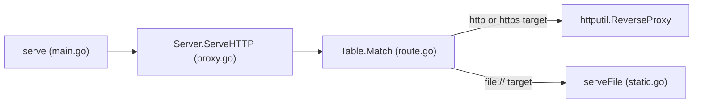

# Architecture

This document describes how the code of quickproxy works. `README.md` describes the route syntax and the proxy behavior for users. All code is in package `main` at the repository root.

## Request path

`main` calls `run` (`cli.go`). The root command runs `serve` (`main.go`). The server sends each request through `Server.ServeHTTP` (`proxy.go`), which uses `Table.Match` (`route.go`) to find a route.

`ServeHTTP` answers some requests before it calls `Table.Match`:

- `/_health` gets `ok`.
- `/` gets the route index page.
- A path with a `.` or `..` segment gets a 400.
- A path that matches no route gets a 404.

## Source files

### main.go

`main` calls `run` and exits with the code that `run` returns. `serve` runs the proxy server until SIGINT or SIGTERM.

Without `--config`, `serve` uses the default route file from `defaultConfigPath`. `serve` creates the directory of the default path. If the default file is missing, the server starts with an empty table, and `watchConfig` loads the file when it appears. A missing file given with `--config` is still an error.

`serve` starts `watchConfig`. If a reload fails, the server logs the error and keeps the old table. A change to `listen` needs a restart. If the file changes `listen`, the server logs a warning.

`serve` logs its own errors and returns an `exitError` with no message.

### cli.go

`run` builds a new Cobra command tree for each call. The root command runs `serve`, or prints the version with `--version`.

`run` returns the exit code. A command returns an `exitError` to set the code. `usageError` gives exit code 2 and a hint to run `--help`. An error from Cobra before `PersistentPreRun`, such as an unknown command or flag, also gives 2. Another error from a command gives 1.

`normalizeArgs` changes the one-dash long flags of older releases, such as `-config`, to `--config`. It changes only flag names that a command defines. It changes nothing after `--`.

### route.go

`route.go` holds the routing logic. `NewTable` compiles the JSON route map into a `Table`. It validates every pattern and target, and it returns all errors together. Duplicate shapes, such as `/a/{x}` and `/a/{y}`, are an error.

`NewTable` sorts the table by precedence: more segments first, then a literal segment before a parameter. `Match` returns the first route that matches.

A `Match` carries three paths, all in escaped (wire) form:

- `Prefix` is the public prefix with the parameter values filled in.
- `Base` is the backend base path.
- `Rest` is the remainder after the prefix.

Matching compares decoded segments, but the proxy sends escaped segments to the backend.

`Match.publicPath` and `Match.rewriteLocation` map backend paths back to the public prefix.

A `file://` target makes a file route. `compileFileRoute` sets `Route.fsPath`. It rejects a host other than `localhost`, a query, a fragment, a relative path and parameters in the path. The file does not have to exist yet.

### proxy.go

`NewServer` makes the `Server` and its `httputil.ReverseProxy`. The route table is in an `atomic.Pointer`. `Server.SetTable` swaps it during live requests without locks.

`ServeHTTP` serves `/_health` and `/` before matching. It sends a request with a `.` or `..` segment a 400. It sends a file route to `serveFile`. For a proxy route with `Rest == ""`, it sends a 308 redirect to the prefix with a trailing slash. For other proxy routes, it stores the `*Match` in the request context under `ctxKey{}` and calls the reverse proxy.

`rewrite`, `modifyResponse` and the `ErrorHandler` read the `*Match` from the request context. `rewrite` sets the backend URL. `modifyResponse` uses `publicPath` and `rewriteLocation` for `Location` headers and `Set-Cookie` paths. If the backend is not reachable, the `ErrorHandler` sends a 502.

The proxy keeps the inbound `X-Forwarded-For`, `X-Forwarded-Host` and `X-Forwarded-Proto` headers, because a local front proxy, such as `tailscale serve`, sets them. It also adds `X-Forwarded-Prefix`. This is safe only on loopback.

`ReverseProxy.FlushInterval` is -1. `statusWriter` records the response status for the request log, and `statusWriter.Unwrap` exposes the real writer.

### static.go

`serveFile` serves a file route. The route serves one regular file at the prefix itself. Directories are not served, and paths below the prefix get a 404. Methods other than GET and HEAD get a 405. The response has `Cache-Control: no-cache`, so that a browser asks again after the file changes.

`redirectToSlash` sends the 308 redirect for a proxy route, and it keeps the query string.

### config.go

`defaultConfigPath` gives `$XDG_CONFIG_HOME/quickproxy/routes.json`, else `~/.config/quickproxy/routes.json`, on macOS and Linux. If `XDG_CONFIG_HOME` is unset or not an absolute path, it uses `~/.config`.

`LoadConfig` reads the file, rejects unknown fields and compiles the routes with `NewTable`. It accepts an empty `routes` map, so that the last route can be deleted. A file without `routes` is an error.

`watchConfig` polls the file mtime and size every 2 seconds. It also reloads on SIGHUP.

### ctl.go

`get`, `create` and `delete` are Cobra commands. They follow kubectl: `VERB RESOURCE [NAMES] [flags]`. `newVerbCmd` makes each verb with one `routes` subcommand that has the aliases `route` and `rt`. The flags are persistent flags on the verb, so that they can come before or after the resource name. Exit codes are 0, 1 (error) and 2 (usage).

`resolveConfigPath` gives the server and the subcommands one path rule.

`modifyConfig` holds a `syscall.Flock` on `<path>.lock`. `saveConfig` validates with `NewTable`, then writes a temp file and renames it over the route file. Thus `watchConfig` never reads a partly written file.

`normalizeTarget` turns a local path given to `create` into an absolute `file://` URL. A local path must start with `/`, `./` or `../`, so that a backend without a scheme is an error. The target must be a regular file. `requireUnderHome` accepts only a path inside the home directory, after it resolves symlinks. These checks run only in `create`, not in `NewTable`.

### update.go

`quickproxy update` is the Cobra command from `newUpdateCmd`. `update.go` does the same steps as `install.sh`:

1. It finds the latest tag from the `releases/latest` redirect.
2. It downloads the archive and compares its SHA-256 sum with `checksums.txt`.
3. It runs the new binary with `-version`.
4. It renames the new binary over `os.Executable()`.

The asset names must match `release.yml`. Its exit codes are 0, 1 (`--check` found a newer release) and 2 (error).

### agent.go

`prime` and `init` are in `agent.go`. `prime` prints `primeGuide`, a guide for AI agents.

`init` adds a Claude Code SessionStart hook that runs `quickproxy prime`. It writes `.claude/settings.local.json`, or `.claude/settings.json` with `--shared`. It keeps the other keys, it adds the hook only once, and it refuses to run in the home directory. If the file is not valid JSON or has an unexpected shape, it fails and writes nothing.

### version.go

`version` is `dev` unless the release build sets it with `-ldflags "-X main.version=<tag>"`. `versionString` adds the short git revision from `debug.ReadBuildInfo` to `version`, and `-dirty` for a modified checkout.

## Invariants

A change must keep these rules:

- Keep the split between escaped and decoded paths. `Match` compares decoded segments, but `Prefix`, `Base` and `Rest` stay in escaped (wire) form, and the proxy sends escaped segments to the backend.
- Keep `ReverseProxy.FlushInterval` at -1, and keep `statusWriter.Unwrap`. Server-sent events and WebSocket upgrades need both.
- Keep `normalizeArgs`. Older releases of `update` and `install.sh` run the new binary with `-version`.
- Keep the `-version` flag in every release. `update` uses it as a smoke test. The smoke test uses the one-dash form, because `update --version` can install an older release that accepts only that form.
- Keep the asset names in `update.go` equal to the names in `release.yml`.
- Keep quickproxy on loopback. It trusts the inbound `X-Forwarded-*` headers.
- Keep the file checks for `create` in `normalizeTarget`, not in `NewTable`.
- Keep the route table swap free of locks. `SetTable` replaces the `atomic.Pointer` during live requests.
- Validate with `NewTable` before you write the route file, and replace the file with a rename.
- If you change the route syntax or the commands, update `primeGuide` too.
